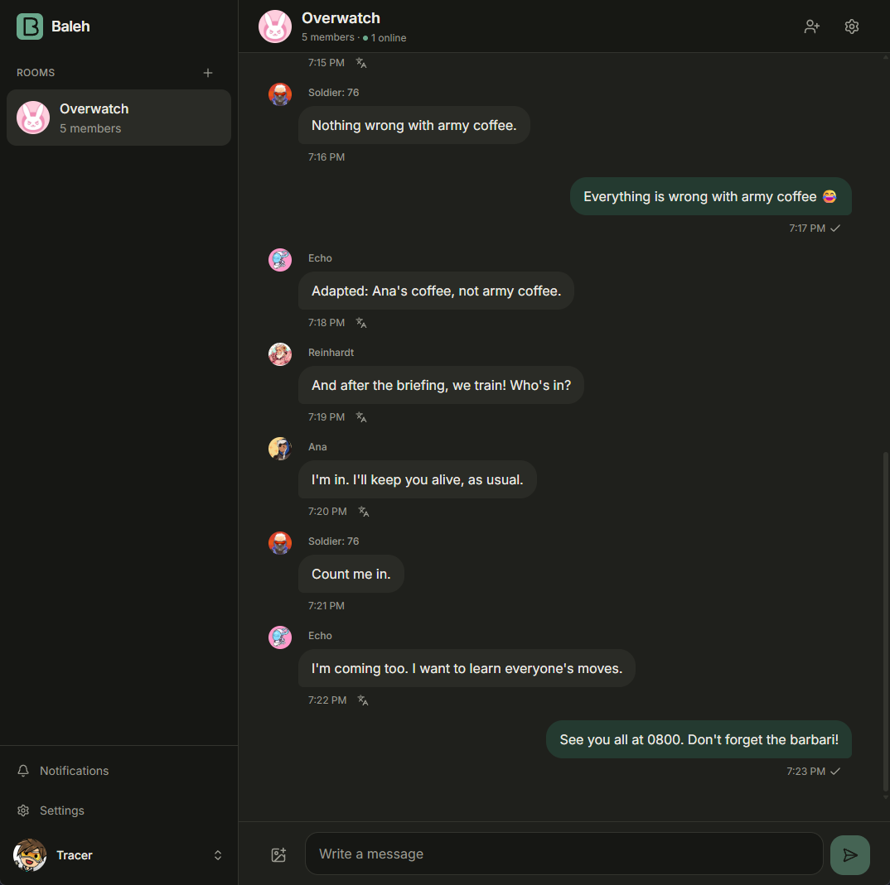
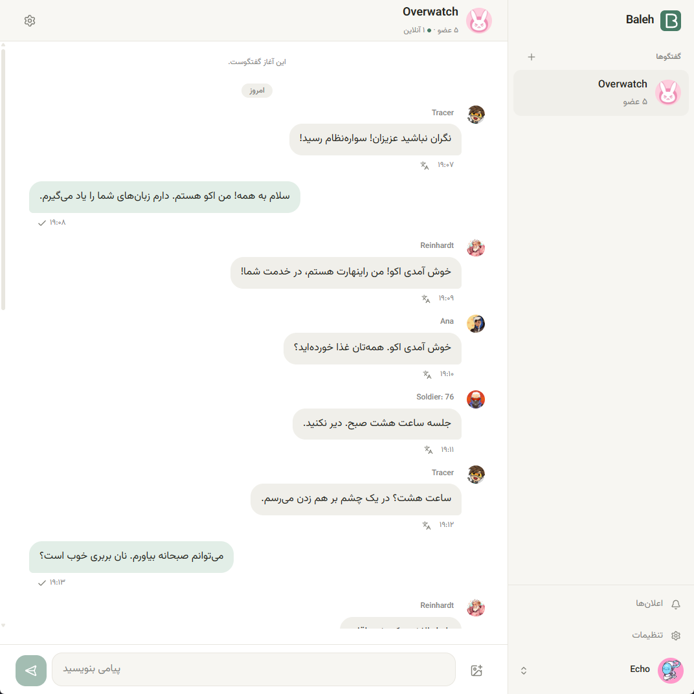
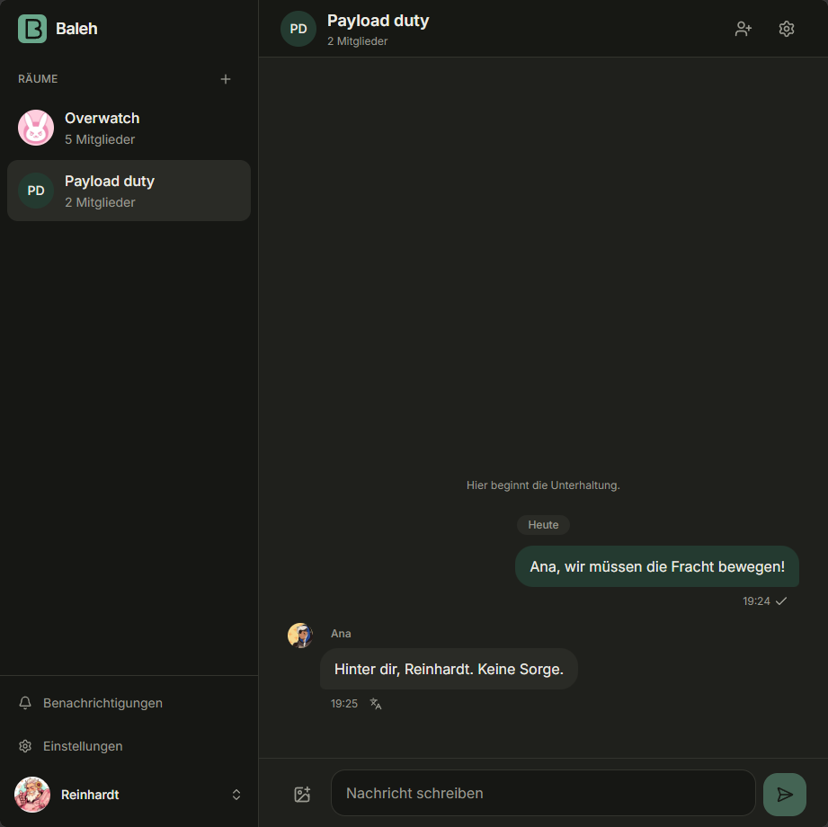
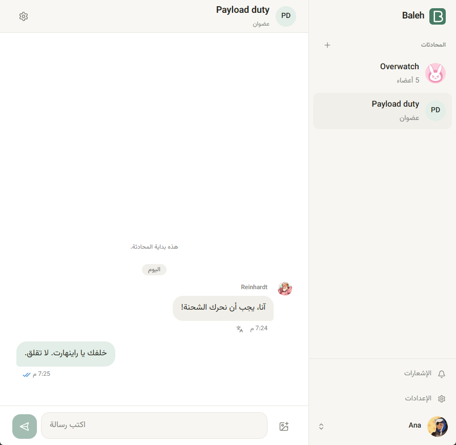
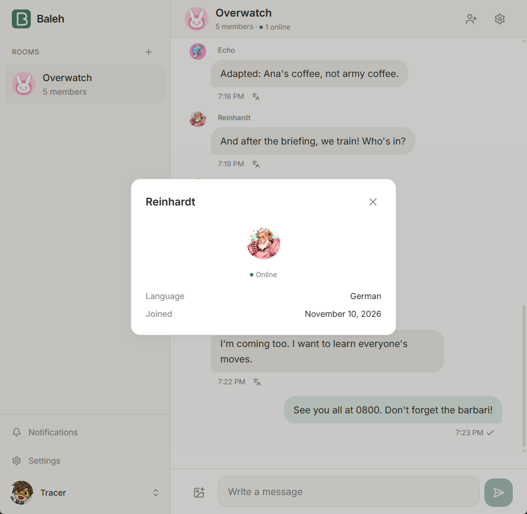
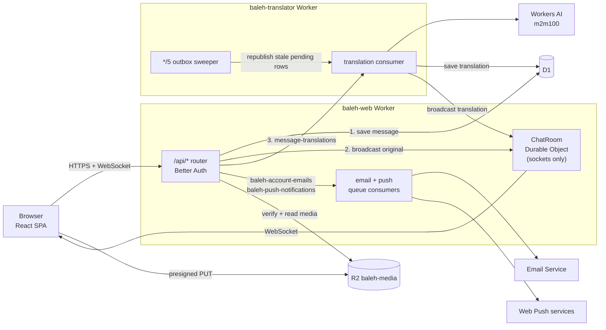

<p align="center"></p>

# Baleh

[](https://github.com/alexraskin/baleh/actions/workflows/test-deploy.yaml)
[](https://workers.cloudflare.com)
[](https://react.dev)
[](https://developers.cloudflare.com/workers-ai/models/m2m100-1.2b/)

A self-hostable, multilingual group chat that runs entirely on Cloudflare. Everyone writes in
their own language and reads everyone else in theirs: messages are translated automatically.

[Self-hosting](#self-hosting) · [Contributing](#contributing)

<details>
<summary><b>Screenshots</b>: one conversation, each person reading it in their own language</summary>
<br>

<table>
  <tr>
    <td></td>
    <td></td>
  </tr>
  <tr>
    <td align="center">English, dark theme</td>
    <td align="center">Persian (right to left), light theme</td>
  </tr>
</table>

<table>
  <tr>
    <td></td>
    <td></td>
    <td></td>
  </tr>
  <tr>
    <td align="center">German</td>
    <td align="center">Arabic</td>
    <td align="center">Member profile</td>
  </tr>
</table>

Screenshots use the demo data from `mise run db:seed:local`.

</details>

**Stack:** React 19, Vite, Tailwind v4, TanStack Query · Cloudflare Workers, D1, Durable
Objects, Queues, Workers AI, R2, Email Service · Better Auth · oxlint, oxfmt, Vitest.

## Development

Requires Node.js 26 (pinned in `mise.toml`; run `mise install`) and a Cloudflare account (for Workers AI in dev).

```sh
npm install
cp .dev.vars.example .dev.vars   # set BETTER_AUTH_SECRET (openssl rand -base64 32)
# local message key (Secrets Store, local copy only)
npx wrangler secrets-store secret create <store-id> --name BALEH_MESSAGE_KEY --scopes workers --value "$(openssl rand -base64 32)"
mise run db:migrate:local
mise run db:seed:local           # optional demo data (password123)
mise run dev                     # http://localhost:5173
```

Dev calls the real Workers AI model, so run `npx wrangler login` first, or
`BALEH_OFFLINE=1 mise run dev` to skip translation. Emails aren't sent in dev; they're printed
to the console and saved under `.wrangler/tmp/email/`.

## Scripts

```sh
mise run check        # typecheck + lint + format:check
mise run test        # Worker tests in the Workers runtime
mise run deploy       # build, deploy web Worker, then translator
mise run cf-typegen   # after changing bindings
mise run db:migrate:remote
```

## How it works



A sent message is saved to D1, broadcast to the room, then queued for translation, so a
failed translation never loses or delays the original. Pending translation rows act as an
outbox: the translator's cron republishes any that go quiet, and jobs that exhaust their
retries land in `message-translations-dlq` and are marked failed.

Message and translation text is encrypted at rest in D1 (AES-256-GCM, `MESSAGE_KEY`), so a
database export or backup holds no conversations. It isn't end-to-end: the Workers decrypt
to translate and serve messages. Media lives in a private R2 bucket, served only to room
members.

## Self-hosting

The checked-in `wrangler.jsonc` and `translator/wrangler.jsonc` point at the demo deployment
(`baleh.dev`). Replace the D1 `database_id`, `routes`, `BETTER_AUTH_URL`, `VAPID_SUBJECT`,
`TURNSTILE_SITE_KEY` and `allowed_sender_addresses` with your own, then run the one-time
setup below.

**1. Database, queues and bucket**

```sh
npx wrangler login
npx wrangler d1 create baleh                 # paste the id into both wrangler.jsonc files
npx wrangler queues create message-translations
npx wrangler queues create message-translations-dlq
npx wrangler queues create baleh-account-emails
npx wrangler queues create baleh-push-notifications
npx wrangler queues create baleh-push-notifications-dlq
npx wrangler r2 bucket create baleh-media
mise run db:migrate:remote
```

Browsers upload straight to R2 with presigned URLs, so the bucket needs a CORS rule for your
site origin. Save this as `cors.json` and apply it with
`npx wrangler r2 bucket cors set baleh-media --file cors.json`:

```json
{
  "rules": [
    {
      "allowed": {
        "origins": ["https://baleh.dev"],
        "methods": ["PUT"],
        "headers": ["content-type"]
      },
      "maxAgeSeconds": 3600
    }
  ]
}
```

Optional: D1 read replication. The Worker already uses the Sessions API (`withSession` plus a
bookmark header), so reads go to the nearest replica and never see older data than the
client's own writes. It can't be set in `wrangler.jsonc`; turn it on in the dashboard (D1 →
`baleh` → Settings → Read replication). Without it, every query goes to the primary.

**2. Email**

Account emails (verification, password reset, security notices) go out through Cloudflare
Email Service. In the dashboard, open Email Service, onboard your domain for sending and let
it add the SPF/DKIM DNS records. The sender addresses in `send_email.allowed_sender_addresses`
must be on that domain.

**3. Secrets** (on `baleh-web`). The message key is one account Secrets Store secret,
`BALEH_MESSAGE_KEY`, bound as `MESSAGE_KEY` in both Workers (`secrets_store_secrets`; set
`store_id` to your store, `npx wrangler secrets-store store list --remote`).

```sh
openssl rand -base64 32 | npx wrangler secret put BETTER_AUTH_SECRET  # rotating signs everyone out
openssl rand -base64 32                         # message key: keep a copy outside Cloudflare
npx wrangler secrets-store secret create <store-id> --name BALEH_MESSAGE_KEY --scopes workers --remote
                                                # paste it; losing it loses every message
npx wrangler secret put R2_ACCOUNT_ID           # Cloudflare account id (R2 S3 endpoint host)
npx wrangler secret put R2_ACCESS_KEY_ID        # R2 API token (Object Read & Write on baleh-media)
npx wrangler secret put R2_SECRET_ACCESS_KEY
node scripts/generate-vapid-keys.ts            # prints the push key pair
npx wrangler secret put VAPID_PUBLIC_KEY
npx wrangler secret put VAPID_PRIVATE_KEY
npx wrangler secret put TURNSTILE_SECRET_KEY    # optional: bot check on auth forms
```

Without `MESSAGE_KEY`, sending fails rather than storing plaintext. Without R2 credentials, uploads return 503 in production. Without VAPID keys, push is off.
Without the Turnstile secret, the bot check is off.

**4. Deploy**

```sh
npx wrangler deploy --dry-run   # check both configs
mise run deploy                 # web first: the translator binds ChatRoom from baleh-web
```

Public signups are controlled by `SIGNUPS_ENABLED` in `wrangler.jsonc`. With them off, create
accounts with `PASSWORD='…' node scripts/create-user.ts <email> <name> [en|fa|ar|de] --remote`.

**5. Continuous deployment (optional)**

The included GitHub Actions workflow runs `mise run check` and `mise run test` on every push and PR,
and on a version tag (`mise run release patch|minor|major`) applies migrations and then deploys. Add `CLOUDFLARE_API_TOKEN` and
`CLOUDFLARE_ACCOUNT_ID` as repository secrets to enable it.

## Contributing

Issues and pull requests are welcome. Before opening a PR:

- Read [`AGENTS.md`](AGENTS.md) for the project layout, conventions and the invariants that
  must not break (encryption at rest, membership checks, idempotent sends and translations).
- Run `mise run check` and `mise run test`; CI runs both.
- Add new UI strings to every locale in `src/locales/`, and use logical (RTL-safe) utilities.
- Add schema changes as a new migration; never edit an applied one.

Please report security issues privately via
[GitHub security advisories](https://github.com/alexraskin/baleh/security/advisories/new)
rather than public issues.

## License

Released into the public domain under the [Unlicense](LICENSE).
